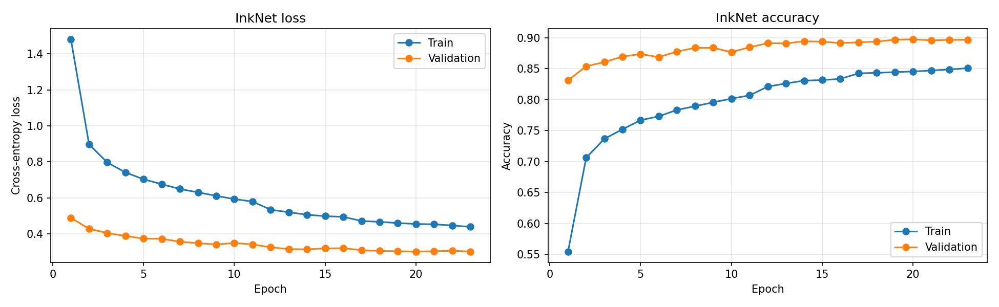
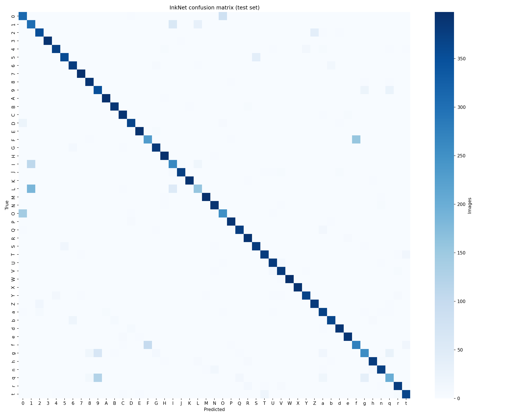

# InkSight: Handwritten Character Recognition

InkSight is a web application that reads handwritten letters and digits. Draw a character on the canvas or upload an image, and a convolutional neural network built in PyTorch predicts which of 47 characters it is and reports exactly how long the prediction took.

## Problem Statement

| | |
|---|---|
| **Project type** | Classifier (multi-class, single label) |
| **Input** | One grayscale image of a single handwritten character, 28 x 28 pixels |
| **Output** | One of 47 classes: digits 0 to 9, uppercase A to Z, and lowercase a, b, d, e, f, g, h, n, q, r, t |
| **Core challenge** | Handwriting varies widely between writers, and several characters look nearly identical when handwritten (O and 0, I, l and 1, S and 5, Z and 2) |

## Dataset

**EMNIST Balanced**, loaded from `torchvision.datasets.EMNIST`: 131,600 handwritten characters (112,800 training, 18,800 test) with an equal number of images per class. Lowercase letters that are written the same way as their uppercase form (such as c and C, o and O) are merged into one class, which is why there are 47 classes instead of 62.

## Model and Training

| Choice | Selection | Reason |
|---|---|---|
| **Architecture** | CNN: 4 convolution layers in 2 blocks, plus 2 fully connected layers | Convolutions detect strokes and curves wherever they appear in the image, which suits handwriting |
| **Baseline** | 2-layer fully connected network | Shows how much the convolutional design adds |
| **Loss function** | Cross-Entropy Loss | Standard for single-label, multi-class classification |
| **Optimizer** | Adam, learning rate 0.001 | Adapts the step size for each weight and converges reliably |
| **Overfitting controls** | Data augmentation, dropout, batch normalization, learning rate scheduling (ReduceLROnPlateau), early stopping | Keeps the model accurate on handwriting it has never seen |
| **Data pipeline** | PyTorch `DataLoader` with batching, shuffling and transforms | Efficient, reproducible training |

## Results

Both models were scored on the 18,800 EMNIST Balanced test images, which neither model saw during training.

| Model | Parameters | Test Accuracy | Macro F1 |
|---|---|---|---|
| Baseline (2-layer fully connected) | 213,039 | 82.41% | 0.8208 |
| **InkNet CNN** | **880,527** | **88.94%** | **0.8879** |

**Inference time:** about 0.006 seconds per image on CPU (0.0057 s averaged over 100 predictions, including preprocessing).

**Where the model struggles:** nearly all errors fall on characters that look alike when handwritten. The most frequent mix-ups on the test set:

| True | Predicted as | Times |
|---|---|---|
| L | 1 | 184 |
| F | f | 157 |
| O | 0 | 143 |
| q | 9 | 124 |
| I | 1 | 110 |

The strongest classes (W, 3 and X) reach an F1 score of 0.99, while the weakest (L at 0.51, q at 0.60, 1 at 0.61) are exactly the ambiguous pairs above.





## Repository Contents

| File | Purpose |
|---|---|
| `app.py` | Gradio web app with drawing canvas, image upload and inference timer |
| `model.py` | CNN definition and image preprocessing shared by the notebook and the app |
| `InkSight_Training.ipynb` | Full training, evaluation and timing workflow |
| `inksight_cnn.pth` | Trained model weights |
| `class_names.txt` | The 47 class labels in model order |
| `requirements.txt` | Python dependencies |
| `examples/` | Sample character images for the app |

## Run Locally

```bash
pip install gradio torch torchvision pillow
python app.py
```
